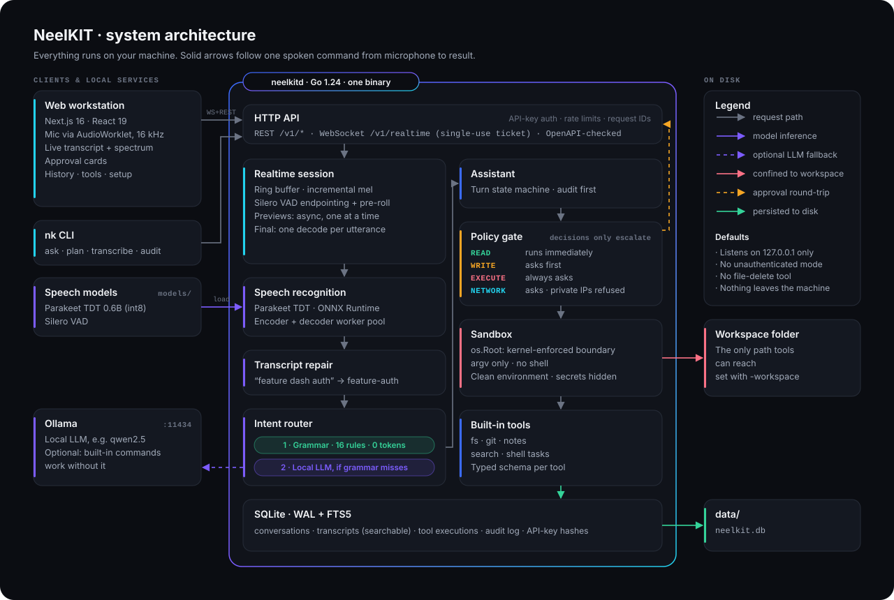
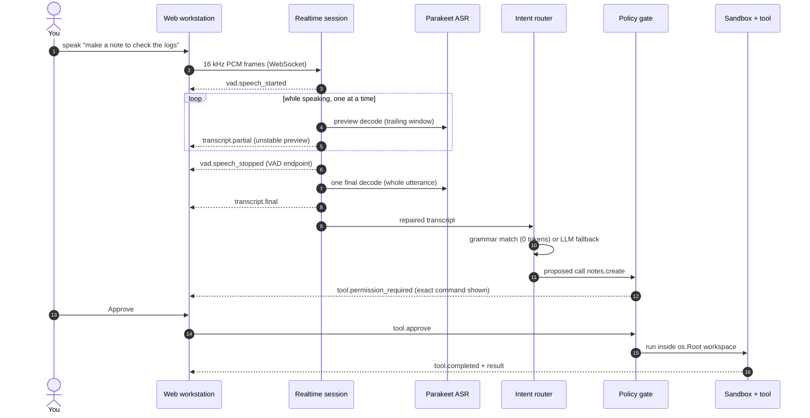

<div align="center">

# NeelKIT

**A local-first voice assistant for developers.**
Speak a command. NeelKIT transcribes it on your machine, works out what you meant,
and runs it, but only after showing you the exact command when it would change anything.

[](https://github.com/neeldas0032/NeelKIT-AI-voice-assistant/actions/workflows/ci.yaml)


[](LICENSE)

[Why it exists](#the-engineering-problem) ·
[Architecture](#architecture) ·
[Quick start](#quick-start) ·
[Usage](#usage) ·
[Safety](#safety-model) ·
[Testing](#testing) ·
[Docs](#documentation)

</div>

<!--
  SCREENSHOT: take one on your own machine and save it as docs/screenshot.png,
  then replace this comment with:

  <p align="center"></p>
-->

---

## Overview

NeelKIT turns speech into developer actions without sending your audio, transcripts
or source code anywhere. Everything runs locally:

```
microphone ─► VAD ─► Parakeet ASR ─► transcript repair ─► intent ─► policy gate ─► sandboxed tool ─► reply
```

| | |
|---|---|
| **Speech recognition** | NVIDIA Parakeet TDT 0.6B (int8 ONNX) on CPU, with Silero VAD for endpointing |
| **Understanding** | A compiled grammar answers everyday commands instantly; an optional local LLM (Ollama) covers the long tail |
| **Execution** | Typed tools for files, git, notes, search and tests, behind a policy gate and an `os.Root` sandbox |
| **Interface** | A real-time web workstation (Next.js) plus the `nk` CLI |
| **Storage** | SQLite (WAL) with FTS5 full-text search over everything you have said |

### Highlights

- **Hands-free.** Voice activity detection decides when you have finished a
  sentence. No wake word, no push button required (push-to-talk is available).
- **Words appear while you speak.** Preview transcripts stream live, and the
  stable transcript arrives as soon as you stop.
- **Fixes what speech recognition gets wrong.** "feature dash auth" becomes
  `feature-auth`, "port eight thousand eighty" becomes `8080`, and "jason"
  becomes `JSON`.
- **Instant for common commands.** Sixteen grammar rules cover everyday git,
  file, note, search and test commands: no model, no tokens, deterministic.
- **Never acts behind your back.** Reads run immediately. Writes, program
  execution and network access show the resolved command and wait for approval.
- **Two independent safety layers.** Even an approved command cannot escape the
  workspace, because the kernel enforces the boundary.
- **Everything is auditable.** Every attempt is written to an audit log before
  it runs, including the ones you deny.

---

## The engineering problem

Parakeet TDT 0.6B is **not a streaming model.** Its encoder attends over the whole
utterance at once, so you cannot feed it audio frame by frame and read words out
of the other end. Many projects that call this model "streaming" buffer the full
recording and stream only the output.

NeelKIT's core contribution is an **incremental decoding scheduler** built around
that constraint:

1. **Incremental features.** Audio lands in an absolute-indexed ring buffer, and
   mel features are computed as it arrives.
2. **Endpointing.** A Silero VAD state machine with hysteresis decides when a
   sentence has ended. It keeps ~320 ms of pre-roll and ~190 ms of post-roll so
   the first and last sounds are not clipped.
3. **Previews off the hot path.** Preview decodes run on their own goroutine,
   at most one at a time, and back off to twice their own cost. A slow CPU
   therefore never stalls audio intake or endpoint detection.
4. **One final decode.** Exactly one decode runs over the finished utterance,
   normalised with whole-utterance statistics as the model was trained, and only
   that result reaches the assistant.

**The trade-off:** previews re-encode recent audio, which is redundant work.
It is bounded by the back-off and a 12-second window, and it is the price of
showing words before the speaker stops. The reasoning, and what breaks if each
choice is wrong, is in [`docs/architecture.md`](docs/architecture.md).

---

## Architecture

<p align="center">
  
</p>

The server is one Go binary. A spoken command moves through it top to bottom:
the **realtime session** decides when you stopped speaking, **speech recognition**
turns the audio into text, **transcript repair** fixes developer vocabulary, and the
**intent router** maps it to a tool call. The call then passes the **policy gate**
and the **sandbox** before it touches your workspace. Anything that would change
something goes back to you as an approval card first.

### One voice command, step by step



A **read** such as "list the files" skips steps 12–14: the policy gate lets it run
immediately.

| Layer | Technology | Notes |
|---|---|---|
| Server | Go 1.24, `net/http`, CGO | Three dependencies: the ONNX binding, the SQLite driver, a WebSocket library |
| Speech | Parakeet TDT 0.6B (int8), Silero VAD | CPU by default; a CUDA execution path exists but is untested on GPU hardware |
| Language model | Ollama (default `qwen2.5`) | Optional; the grammar tier works without it |
| Storage | SQLite in WAL mode, FTS5 | Prefix search over every transcript |
| Interface | Next.js 16, React 19, TypeScript, Tailwind 4 | Self-hosted fonts, no CDN calls |
| API | REST + WebSocket | [`docs/openapi.yaml`](docs/openapi.yaml), checked against the router in CI |

---

## Quick start

### Requirements

| | |
|---|---|
| OS | Linux, or Windows with **WSL2** (Ubuntu) |
| Toolchain | Go 1.24+, Node.js 22+, ONNX Runtime 1.25.x, `make` |
| Disk | About 1 GB for speech models, plus ~2 GB for the optional LLM |
| Hardware | A modern CPU is enough; no GPU required |

### 1. Install ONNX Runtime

```bash
curl -fsSL -o /tmp/ort.tgz \
  https://github.com/microsoft/onnxruntime/releases/download/v1.25.1/onnxruntime-linux-x64-1.25.1.tgz
sudo tar -xzf /tmp/ort.tgz -C /opt
sudo mv /opt/onnxruntime-linux-x64-1.25.1 /opt/onnxruntime
```

### 2. Clone, download models, build

```bash
git clone https://github.com/neeldas0032/NeelKIT-AI-voice-assistant.git
cd NeelKIT-AI-voice-assistant

make models     # speech + VAD models, about 700 MB, once
make build      # bin/neelkitd, bin/nk, bin/nkbench
```

### 3. Start the server

Point `-workspace` at the one project folder the assistant may touch. Tools cannot
reach anything outside it.

```bash
export LD_LIBRARY_PATH=/opt/onnxruntime/lib
./bin/neelkitd -workspace ~/dev/my-project -llm none
```

On first start the server prints an **API key once**. Copy it. Only a salted hash
is stored, and the key keeps working across restarts. If you lose it, restart with
`-rotate-key`.

### 4. Start the interface

```bash
cd web
npm install
npm run build && npm start
```

Open **http://localhost:3000**, paste the key into **Setup**, and press the orb.

### 5. (Optional) Turn on the local language model

```bash
curl -fsSL https://ollama.com/install.sh | sh
ollama pull qwen2.5:3b-instruct

./bin/neelkitd -workspace ~/dev/my-project -llm ollama -llm-model qwen2.5:3b-instruct
```

The model is warmed at startup and kept loaded, so the first question does not pay
the load time. On CPU, `qwen2.5:3b-instruct` is the recommended balance of speed
and quality.

<details>
<summary><b>Windows (WSL2) notes</b></summary>

- Run every command inside WSL (`wsl` from PowerShell), not in PowerShell itself.
- Quote paths that contain spaces: `cd "/mnt/d/Projects/My Folder"`.
- Install web packages from WSL only. Mixing Windows and Linux `node_modules`
  breaks native dependencies.
- Keeping the WSL distribution on a drive with free space is fine. Ollama models
  live inside the distribution.

</details>

<details>
<summary><b>Docker Compose</b></summary>

```bash
export NEELKIT_WORKSPACE=~/dev/my-project
docker compose up                       # server + interface
docker compose --profile llm up         # also start Ollama
docker compose logs neelkitd | grep -A2 'API key'
```

The first start downloads the speech models into a named volume.

</details>

---

## Usage

### Say, or type

| You say | What happens |
|---|---|
| "list the files" | Lists the workspace root, immediately |
| "what branch am I on" | Runs `git rev-parse --abbrev-ref HEAD` |
| "what changed since my last commit" | Shows the diff |
| "create a git branch called feature dash auth" | Creates `feature-auth`, **after asking** |
| "make a note to refactor the audio ring buffer" | Appends to `NOTES.md`, **after asking** |
| "run the tests" | Runs the configured test task, **after asking** |
| "search my project for authentication logic" | Code search across the workspace |
| "what does this project do?" | Falls through to the local LLM, if enabled |

### Command line

```bash
nk doctor                         # health of every subsystem
nk ask "run the tests"            # one turn, end to end
nk plan "make a note buy milk"    # show what would run, change nothing
nk transcribe meeting.m4a --words # offline transcription with timestamps
nk history authentication         # full-text search over everything said
nk audit 24                       # everything executed in the last 24 h
```

### Configuration

Every flag also has a `NEELKIT_*` environment variable (for example `-workspace`
is `NEELKIT_WORKSPACE_ROOT`).

| Flag | Default | Purpose |
|---|---|---|
| `-workspace` | `~/dev` | The only directory tools can reach |
| `-read-only` | `false` | Disable every write and execute tool |
| `-llm` | `ollama` | `ollama` or `none` |
| `-llm-model` | `qwen2.5:7b-instruct` | Any Ollama model tag |
| `-models` | `./models` | Speech model directory |
| `-device` | `cpu` | `cpu`, or `cuda` (untested on GPU hardware) |
| `-workers` | half the CPUs, max 4 | Concurrent decoder workers |
| `-data` | `./data` | Database directory |
| `-addr` | `127.0.0.1:8420` | Listen address (loopback by default) |
| `-rotate-key` | — | Revoke the stored API key and print a new one |
| `-log-format` | `json` | `json` or `text` |

---

## Safety model

The assistant runs programs because you asked out loud, and speech recognition makes
mistakes. A confirmation prompt alone is one layer, and a user who clicks through it
has no protection left. NeelKIT has **two independent layers that do not share a
decision.**

```
$ ./scripts/demo-sandbox.sh

1. The policy gate escalated
   a read is normally allowed outright, but:
   "../../etc/passwd" points outside the project tree

2. Approving it anyway — the worst thing a user can do

3. The sandbox refused it regardless
   tools: path is outside the workspace: "../../etc/passwd"
```

| Risk class | Behaviour |
|---|---|
| **Read** | Runs immediately |
| **Write** | Asks first, showing the resolved command |
| **Execute** | Always asks; cannot be configured to auto-run |
| **Network** | Asks first; loopback, private ranges and cloud metadata are refused outright |

Further controls:

- **Kernel-enforced boundary.** Paths resolve through Go 1.24 `os.Root`, so the
  kernel blocks escapes, including through a symlink created after a check passed.
- **No shell.** Programs get an explicit argv. Shell metacharacters in a plan are
  treated as evidence the plan is wrong, and the call is refused and logged.
- **Clean environment.** Child processes get a constructed environment, so
  secrets like `GITHUB_TOKEN` never reach a tool.
- **Credentials are off-limits.** `.env`, `*.pem`, `.ssh/` and `.aws/` are
  unreadable even to read tools.
- **What you see is what runs.** Tests assert that the previewed command is the
  command executed.
- **Locked down by default.** There is no unauthenticated mode and no
  file-delete tool. The server listens on loopback only.

The threat model is in [`docs/security.md`](docs/security.md).

---

## Testing

```bash
make test        # all Go tests
make test-race   # under the race detector
make e2e         # Playwright, real browser + real server + real sandbox
```

- **No 700 MB model needed.** The suite runs on a clean checkout because the
  engine tests use a small synthetic ONNX model with the real checkpoint's exact
  I/O signature (`scripts/gen_testmodel.py`).
- **Real speech for the realtime path.** Regression tests drive the session with
  a synthesised spoken fixture and a deliberately slow decoder. They cover
  preview back-pressure, utterance boundaries after cancel and push-to-talk, and
  stale previews arriving after a final.
- **End-to-end approval tests.** These assert that a read runs unprompted, a write
  writes nothing until approved, a denial leaves the disk untouched, and an
  approved path traversal still fails.
- **The API docs cannot drift.** `TestOpenAPIMatchesTheRouter` fails the build if
  a route is undocumented or documentation describes a route that does not exist.
- **The policy gate is property-tested.** 5,000 random inputs check that
  decisions can only escalate, never relax.

---

## Performance

**No numbers are published yet, on purpose.** The harness exists and the method
is written down. The results tables stay empty until they are measured on real
hardware with a real speech corpus.

```bash
make measure CORPUS=./testdata/speech
```

`nkbench` reports the real-time factor, latency percentiles and grammar routing
cost. Given reference transcripts, it also reports **word error rate** and a
side-by-side table of what was heard against what was said. See
[`docs/performance.md`](docs/performance.md).

---

## Project structure

```
cmd/
  neelkitd/          server: wires the graph, serves, shuts down in order
  nk/                CLI client — talks to the public API only
  nkbench/           benchmark + WER harness; ships no numbers of its own
internal/
  audio/             WAV, resampling, mel features, ring buffer
  vad/               Silero session + endpointing state machine
  asr/               engine interface; onnx/ is the Parakeet implementation
  realtime/          live session: previews, endpointing, final decode
  normalize/         transcript repair for spoken developer vocabulary
  intent/            grammar tier, then the LLM tier
  llm/               provider interface; Ollama implementation
  tools/             contract, registry, policy gate, sandbox, built-in tools
  assistant/         the turn state machine
  storage/           SQLite, migrations, FTS5
  httpapi/           REST + WebSocket transport
web/                 Next.js workstation + Playwright e2e tests
docs/                architecture, API, security, performance, design system
```

---

## Documentation

| Document | Contents |
|---|---|
| [`architecture.md`](docs/architecture.md) | Every design decision, the alternatives rejected, and the concurrency model |
| [`api.md`](docs/api.md) · [`openapi.yaml`](docs/openapi.yaml) | REST and WebSocket reference |
| [`security.md`](docs/security.md) | Threat model and controls |
| [`tool-system.md`](docs/tool-system.md) | The tool contract, and how to add a tool |
| [`data-model.md`](docs/data-model.md) | Schema, indexes, retention |
| [`performance.md`](docs/performance.md) | Measurement method (numbers pending) |
| [`design-system.md`](docs/design-system.md) | The interface design system |
| [`roadmap.md`](docs/roadmap.md) | What is next, and what was deliberately left out |
| [`CHANGELOG.md`](CHANGELOG.md) | Changes, including bugs found by running it on real hardware |

---

## Limitations

- **CPU latency.** On a laptop CPU, speech becomes text in roughly a second after
  you stop speaking. The optional LLM takes several seconds per answer, so
  built-in commands are the fast path.
- **Not a general chatbot.** NeelKIT is a command assistant scoped to one
  workspace. Open-ended questions depend on the local model you choose.
- **Mainly tested in English.** The checkpoint is multilingual, but the grammar
  and transcript repair are written for English developer vocabulary.

---

## Acknowledgements

- [`achetronic/parakeet`](https://github.com/achetronic/parakeet) (Apache-2.0):
  the reference ONNX integration for this model, which NeelKIT studied and built on.
- [NVIDIA Parakeet TDT 0.6B](https://huggingface.co/nvidia/parakeet-tdt-0.6b-v3),
  via the [ONNX export by istupakov](https://huggingface.co/istupakov/parakeet-tdt-0.6b-v3-onnx).
- [Silero VAD](https://github.com/snakers4/silero-vad) (MIT) and
  [ONNX Runtime](https://github.com/microsoft/onnxruntime) (MIT).

[`ATTRIBUTION.md`](ATTRIBUTION.md) lists exactly what is borrowed, what is
original, and what is not claimed. NeelKIT does not claim the model or its
architecture.

## License

Apache-2.0. See [`LICENSE`](LICENSE) and [`NOTICE`](NOTICE).
